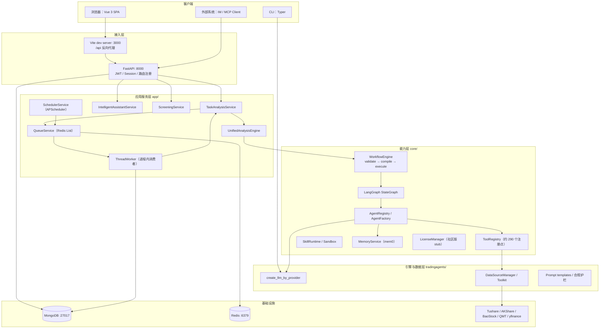
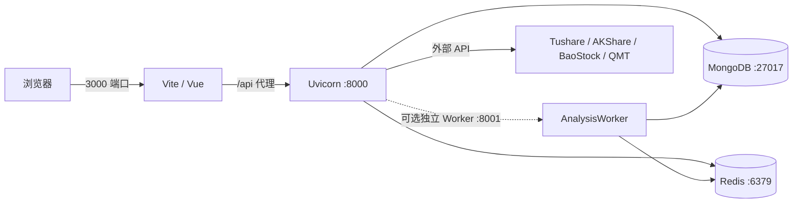
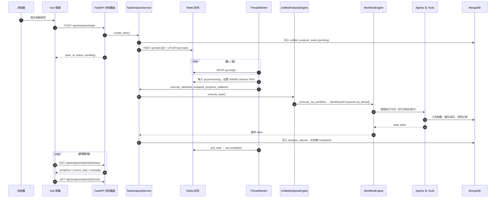
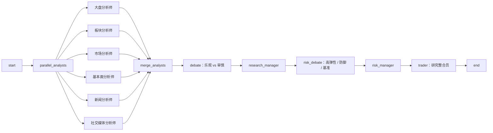

```{r setup, include=FALSE}
knitr::opts_chunk$set(echo = FALSE, warning = FALSE, message = FALSE)
```

```{=html}
<script type="module">
import mermaid from "https://cdn.jsdelivr.net/npm/mermaid@10/dist/mermaid.esm.min.mjs";
mermaid.initialize({ startOnLoad: true, theme: "neutral" });
</script>
```

> 报告对象：`/Data/TradingAgents`，VERSION `3.0.0`，BUILD_INFO `3.0.0-beta.4-build20260816-221009`，git HEAD `5105a76`（2026-09-22，社区版首发）。
>
> 生成日期：2026-11-04。方法：代码静态阅读 + 运行态检查（本机 8000 / 3000 / 27017 / 6379 均在监听）。
>
> **说明**：本报告由 AI 基于当前代码快照生成，尚未经过完整人工复核。文中的行号、默认值和模块行为可能随版本变化；凡涉及"当前实现"的判断，均以本快照为准。本项目输出仅供学习研究，不构成投资建议。

## 1. 摘要

交易分析智能体（TradingAgents CN）是一个面向 A 股市场的**多智能体研究辅助系统**：它把行情、财务、新闻、舆情等证据采集，交给扮演不同角色的 LLM 智能体并行分析、正反辩论、风险质证，最后汇总为一份可追溯的研究报告。系统同时提供自然语言选股、AI 助手、Skill 中心、模拟交易与学习课程。

从工程上看，它不是一个单体脚本，而是四层分离的完整产品：

| 层 | 目录 | 技术 | 职责 |
|---|---|---|---|
| 展示层 | `frontend/` | Vue 3 + TypeScript + Vite + Pinia + Element Plus | 页面、路由、状态、SSE/WS 消费 |
| 接入层 | `app/` | FastAPI + Motor + Redis + APScheduler | HTTP API、认证、任务队列、调度、报告落库 |
| 能力层 | `core/` | 自研 Agent/Workflow/Tool/Skill/Memory 框架 | 智能体运行时、声明式工作流、工具与技能、记忆与知识 |
| 引擎与数据层 | `tradingagents/` | LangGraph + LangChain + 数据源适配 | LLM 工厂、数据获取与降级、提示词、旧版图引擎 |

三条最值得先记住的结论：

1. **v3.0 的生产分析链路已经不再是 `TradingAgentsGraph`**。生产入口走 `core/workflow/engine.py::WorkflowEngine`，它把 MongoDB 中的工作流定义编译成 LangGraph；旧的 `TradingAgentsGraph` 与 `legacy` 引擎在代码中被显式拒绝或标记停用，只保留给 CLI、演示和兼容层。
2. **系统的核心设计是"配置即数据、流程即数据"**。模型、提示词、Agent、工具绑定、数据源优先级、工作流都存放在 MongoDB，`.env` 主要承担密钥与启动参数；`app/core/config_bridge.py` 再把数据库配置桥接回环境变量，供旧引擎读取。
3. **运行形态是"FastAPI + Redis 队列 + 进程内 Worker + MongoDB"**。HTTP 请求只负责创建任务并立即返回，`ThreadWorker` 在后台消费 Redis 队列执行工作流；前端对分析任务采用**轮询**，对 AI 助手采用 **SSE**。

## 2. 项目定位与版本

### 2.1 是什么、不是什么

- 是：A 股研究辅助工具，强调"研究结论、关键依据、风险揭示与情景分析"。
- 不是：交易指令系统。合规提示词明确禁止输出买卖/持有判断、目标价、止损止盈、仓位建议与择时结论。
- 许可：混合授权。`tradingagents/`、`cli/`、`docs/`、`tests/` 为 Apache-2.0；`app/`、`frontend/`、`core/` 为 source-available 专有组件，禁止再分发与商业使用。

### 2.2 版本演进

| 版本 | 定位 | 关键变化 |
|---|---|---|
| v1.0 | 多智能体分析工具 | 单股研究、批量分析，多个分析师协作 |
| v2.0 | 分析融入研究闭环 | 统一分析引擎、可视化工作流、持仓分析与复盘 |
| v2.1 | 研究辅助合规化 | 报告表达、提示词模板、界面文案对齐"研究辅助" |
| v3.0 | 从分析工具到 AI 助手 | FastAPI + Vue 3 + MongoDB/Redis，统一助手入口、自然语言选股、Agent 自主规划、Skill 扩展 |

### 2.3 技术栈

| 领域 | 选型 |
|---|---|
| 后端框架 | FastAPI、Uvicorn、Pydantic v2、python-multipart |
| 数据库/缓存 | MongoDB（Motor + PyMongo）、Redis |
| 任务与调度 | 自研 Redis 队列、APScheduler、ThreadPoolExecutor |
| 智能体编排 | LangGraph `StateGraph`、LangChain ChatModel |
| LLM 接入 | OpenAI 兼容、DeepSeek、DashScope、Google、Anthropic、智谱、火山方舟、千帆、Ollama、OpenRouter 等 |
| 数据源 | Tushare、AKShare、BaoStock、yfinance、Finnhub、Alpha Vantage、QMT、本地/MongoDB |
| 记忆/知识 | mem0（MemoryService）、ChromaDB/Qdrant/MongoDB 向量存储、RAG |
| 文档处理 | python-docx、WeasyPrint、pdfkit、openpyxl、pandas |
| 前端 | Vue 3.4、TypeScript 5.3、Vite 5、Pinia 2、Element Plus 2.4、ECharts 5 |
| CLI | Typer + Rich |
| 测试 | pytest（约 1850 个测试函数）、Playwright（`e2e/` 9 个 spec） |

### 2.4 代码规模（本快照）

| 目录 | 文件数（py/ts/vue） | 行数 |
|---|---:|---:|
| `app/` | 265 | 147,566 |
| `core/` | 352 | 142,118 |
| `tradingagents/` | 131 | 51,645 |
| `frontend/src/` | 205 | 96,362 |
| `cli/` | 7 | 3,414 |
| `migrations/` | 12 | 1,141 |
| `tests/` | 477 | 81,657 |

合计约 52.4 万行。规模已经接近中型商业产品，理解成本主要来自"多代实现并存"，而不是单个模块的复杂度。

## 3. 总体架构

### 3.1 分层与组件



### 3.2 目录职责

| 路径 | 职责 | 备注 |
|---|---|---|
| `tradingagents/` | 旧版 `TradingAgentsGraph`、LLM 工厂、数据源与缓存、提示词客户端、工具适配 | Apache-2.0；仍是数据与 LLM 基础设施 |
| `core/agents/` | `BaseAgent`、注册表、工厂、47 个 `@register_agent` 实现、后处理器 | v2/v3 Agent 框架 |
| `core/workflow/` | 工作流 DSL、校验器、LangGraph 构建器、引擎、模板、报告聚合 | v3 生产编排核心 |
| `core/tools/` | `ToolRegistry`、内置工具实现、MCP 客户端、外部 Skill 沙箱 | 约 290 个 `@register_tool` 注册点 |
| `core/skills/` + `core/skill_runtime/` | `SKILL.md` 解析、函数调用转换、脚本执行、生成代码可用的只读数据 API | Skill 中心底座 |
| `core/memory/` + `core/knowledge/` | mem0 统一记忆、向量存储、RAG | 记忆有 conversation/user_preference/analysis_insight 等 scope |
| `core/llm/` | `UnifiedLLMClient` 与 OpenAI/Google/Anthropic 适配器 | 与 LangChain 栈并存 |
| `core/api/` | `WorkflowAPI`、`AgentAPI` 领域服务 | 不是 HTTP 路由 |
| `app/routers/` | HTTP 路由与鉴权 | 约 54 个社区版路由 |
| `app/services/` | 任务、分析、助手、筛选、调度、配置、组合等业务服务 | 约 7 万行 |
| `app/worker/` | 独立 Worker 进程、数据同步任务 | 可选部署 |
| `frontend/src/` | 页面、组件、Pinia store、API 客户端、SSE/WS 工具 | Vite 代理 `/api` 到 8000 |
| `migrations/` | 版本化 MongoDB 迁移 | 启动时自动执行 |
| `install/community_bootstrap.json` | 社区版首次启动最小配置包 | 仅在集合为空时导入 |

### 3.3 两代引擎的关系（关键）

这是理解本项目最重要的结构性事实。

| 代际 | 编排方式 | 现状 |
|---|---|---|
| v1/v2 | `tradingagents/graph/trading_graph.py::TradingAgentsGraph` 硬编码 LangGraph 节点与边 | 仍可被 `main.py`、`cli/main.py` 直接调用；Web 生产链路已停用 |
| v3 | `core/workflow/engine.py::WorkflowEngine` 读取 `WorkflowDefinition`，由 `core/workflow/builder.py` 编译为 LangGraph | Web 生产链路默认引擎 |

证据：`app/services/analysis_service.py` 的 `_get_trading_graph` 直接 `raise RuntimeError("TradingAgentsGraph 不再实例化")`；`app/services/unified_analysis_engine.py::_select_engine` 拒绝 `legacy`；`app/services/simple_analysis_service.py` 的旧执行路径同样标记停用。因此：

- `core/workflow` **不是替换 LangGraph**，而是替换了"把图写死在代码里"的做法，改为"从数据库读取图定义，再编译成 LangGraph"。
- `tradingagents/` 仍然提供 LLM 工厂、数据源、提示词模板、`Toolkit` 等基础设施，并没有被整体废弃。
- 两套 LLM 栈并存：工作流 Agent 用 LangChain `BaseChatModel`（`create_llm_by_provider`），回测与工作流生成器用 `core.llm.UnifiedLLMClient`。

### 3.4 部署拓扑



- `start.sh`：启动 `ta-redis` 容器（密码取自 `.env`）、检查 `mongod`、以 `setsid` 启动后端与前端，日志写入 `logs/`。
- `deploy/systemd/`：三个用户级 unit —— `tradingagents-deps`（等 MongoDB/Redis）、`tradingagents-backend`、`tradingagents-frontend`。
- `start_dev.py`：可用 `--backend-only` / `--worker-only` / `--no-worker` 控制进程；Windows 对应 `start_backend.ps1` 与 `start_worker.ps1`。
- 仓库内没有 Dockerfile、docker-compose 或 nginx 配置；systemd 的前端 unit 直接运行 `npm run dev`（Vite 开发服务器），而不是构建后的 `dist/`。

## 4. 开发原理

这里的"开发原理"既指系统的设计哲学，也指团队把这种哲学落到代码里的方式。

### 4.1 原则总览

| 原则 | 具体做法 | 代码证据 |
|---|---|---|
| 分层与许可解耦 | 引擎、能力层、应用层、展示层物理分离；回测通过 HTTP 调用外部 Backtrader 服务，保持进程与许可证隔离 | `tradingagents/`、`core/`、`app/`、`frontend/` 四个顶层目录；`core/backtest/engine_client.py` |
| 配置即数据 | 模型目录、厂商密钥、数据源优先级、提示词、Agent 配置、工具绑定、工作流均存 MongoDB；`.env` 只做引导与密钥兜底 | `app/services/config_service.py`、`app/core/config_bridge.py`、`config/*.json` |
| 注册表与元数据驱动 | Agent、工具、分析师、状态字段都通过注册表 + 元数据描述能力、输入输出、工具、执行顺序 | `core/agents/registry.py`、`core/tools/registry.py`、`core/agents/analyst_registry.py` |
| 流程即数据 | 工作流用 `WorkflowDefinition`（节点 + 边 + 输入/输出配置）描述，可存库、可在前端编辑、可版本化 | `core/workflow/models.py`、`core/workflow/engine.py`、`core/workflow/builder.py` |
| 契约驱动状态 | Agent 元数据声明 `inputs`/`outputs`/`output_field`；引擎动态生成 `TypedDict` 状态与 reducer，避免全局大状态硬编码 | `core/state/builder.py`、`core/state/reducers.py`、`core/agents/config.py` |
| 提示词与合规内建 | 提示词从 `prompt_templates` 读取，按 `agent_type`/`agent_name`/偏好选择；统一追加"禁止交易建议"护栏 | `tradingagents/utils/template_client.py`、`core/agents/base.py::_apply_global_trading_advice_guard`、`tradingagents/agents/utils/compliance_prompting.py` |
| 稳健性与优雅降级 | 数据源多级 fallback、LLM 重试、报告质量门禁、模板失败回退硬编码、记忆失败返回空、任务失败可重试 | `core/agents/quality_gate.py`、`core/utils/retry.py`、`tradingagents/dataflows/data_source_manager.py` |
| 可观测与可追溯 | 请求 `X-Request-ID`/trace_id、操作日志、`workflow_agent_invocations` 调用记录、token/成本统计、质量指标 | `app/middleware/request_id.py`、`app/services/operation_log_service.py`、`workflow_agent_invocations`、`token_usage` |
| 渐进式演进 | 旧模块保留 `DEPRECATED` 头并指向替代实现；旧引擎以 `legacy` 名称保留但拒绝执行；社区/Pro 通过发布管道裁剪 | `tradingagents/tools/unified_news_tool.py` 头部、`core/workflow/builder.py::_try_create_legacy_agent`、`core/licensing/community_stub.py` |
| 安全边界前置 | JWT + 服务端会话、审批状态、日配额/并发限制、危险工具 HITL 确认、生成代码 AST 校验 + 子进程沙箱 | `app/routers/auth_db.py::get_current_user`、`core/hitl/checkpoint_store.py`、`core/tools/external/static_validator.py` |

### 4.2 配置即数据：三层来源与桥接

配置有三层，优先级随场景不同：

1. **`.env`**：数据库连接、JWT 密钥、管理员初始密码、端口、少量开关。它是启动前提，也是密钥的最后兜底。
2. **MongoDB `system_configs` / `llm_providers` / `model_catalog` / `prompt_templates` / `agent_configs` / `tool_configs` / `tool_agent_bindings` / `workflows`**：运行时权威来源，用户在 Web 设置页修改后即时生效。
3. **`config/*.json`**：社区版种子与数据库不可用时的后备；`config/README.md` 明确这些文件会被自动生成，修改前需备份。

`app/core/config_bridge.py::bridge_config_to_env()` 是这套设计的关键接缝：启动时把数据库中的厂商 API Key、默认快慢模型、数据源 token/超时/限流/TTL、系统运行时参数写入 `os.environ`，因为 `tradingagents/` 的旧代码是通过环境变量读取配置的。桥接完成后再重新初始化 `tradingagents` 的 MongoDB 存储与定价表。这样既保留了"用户在界面改配置"的体验，又不用重写旧引擎的配置读取逻辑。

代价是配置来源多、排查链路长：同一个值可能同时存在于 `.env`、MongoDB、`config/*.json` 与环境变量中，且不同模块的优先级并不完全一致（例如厂商 Key 是 `.env` 优先，Tushare Token 是数据库优先）。排查配置问题时，应同时检查这四处。

### 4.3 Agent 即插件：注册表 + 工厂 + 元数据

一个 Agent 的最小定义是：

```python
@register_agent
class MarketAnalystV2(AnalystAgent):
    metadata = AgentMetadata(
        id="market_analyst_v2",
        category=AgentCategory.ANALYST,
        inputs=[...],
        outputs=[AgentOutput(name="market_report", ...)],
        output_field="market_report",
        default_tools=["get_stock_market_data_unified"],
        max_tool_calls=3,
        execution_order=10,
        workflow_stage="analyst",
    )
```

`AgentRegistry` 保存类与元数据，`AgentFactory.create()` 负责实例化；当注册表中没有对应类、但数据库 `agent_configs` 中有配置时，回退到 `UniversalAgent`（完全由数据库配置驱动的通用 Agent）。工具绑定按"节点绑定 → 工作流绑定 → Agent 默认工具"三级解析（`BindingManager.get_tools_for_node`）。提示词按 `agent_type`/`agent_name`/`preference_id` 从模板库解析，失败时使用类内硬编码提示词。

这种设计的收益是**新增一个角色通常不需要改编排代码**：注册类、写元数据、在数据库绑定工具与提示词、在工作流里加一个节点即可。代价是行为高度依赖数据库状态，代码阅读只能看到"能力上限"，看不到"当前实际配置"。

### 4.4 工作流即数据：DSL 到 LangGraph

`WorkflowDefinition` 是一个可序列化的图：

- 节点类型：`START`、`END`、`ANALYST`、`RESEARCHER`、`TRADER`、`RISK`、`MANAGER`、`CONDITION`、`PARALLEL`、`MERGE`、`DEBATE`、`POST_PROCESSOR`。
- 边类型：`NORMAL`、`CONDITIONAL`。
- 节点可带 `agent_id`、`config`（角色、焦点、轮次引用）、`position`（前端画布坐标）。
- 工作流可带 `input_config`（表单字段）、`output_config`（产出物组装策略）、`workflow_type`。

运行时链路是：

```
WorkflowEngine.load() → WorkflowValidator.validate() → WorkflowBuilder.build()
   → LangGraph StateGraph.compile() → engine.execute(stream_mode="updates")
```

`WorkflowBuilder` 负责把每种节点翻译成 LangGraph 节点函数：普通 Agent 节点走 `_create_agent_node`，条件节点走条件边，`PARALLEL`/`MERGE` 做扇出/汇合，`DEBATE` 生成多轮条件边。状态 schema 默认动态生成（`StateRegistry` + `StateSchemaBuilder`），按 Agent 的输入输出字段合并并挂 reducer；生成失败时回退到 `builder.py` 中的静态大 schema。

### 4.5 契约驱动与报告聚合

Agent 元数据不仅用于展示，也用于**报告组装**：`output_field` 告诉引擎把结果写到哪个 state 字段，`ReportAggregator` 从元数据发现字段而不是硬编码字段名。这样新增分析师时，报告页与导出模块无需逐一改字段列表。质量门禁则在分析师产出后检查结构完整性，critical 时重试一次，仍失败则写入 `quality_flags` 并记录质量指标。

### 4.6 合规内建

合规不是事后过滤，而是提示词的一部分：

- `compliance_prompting.py` 定义通用禁止项与各角色输出要求；
- `BaseAgent._apply_global_trading_advice_guard()` 在每个 Agent 的最终提示词后追加统一约束；
- 报告文案、前端界面、用户手册统一使用"研究参考/情景分析"表述。

需要指出一个张力：旧的 `SignalProcessor` 仍要求 LLM 输出 `买入/持有/卖出` 与目标价，这与合规模板冲突。v3 的 Web 链路不再依赖该信号处理器，但 CLI 与旧引擎仍会调用它；在这条路径上，`action` 很可能因合规提示而退化为"持有"。

### 4.7 稳健性设计

- **数据源**：`DataSourceManager` 从 MongoDB 读取按市场分类的优先级，逐级 fallback；缓存层有文件、MongoDB+Redis、自适应三种实现。
- **LLM**：`UnifiedLLMClient` 按 `retry_times` 指数退避；`jdyun` 厂商额外加 1 并发信号量与 3/6/12 秒退避；流式失败自动回退非流式。
- **Agent**：工具调用有最大轮次与分析师大类上限；报告有质量门禁；模板缺失有硬编码兜底。
- **任务**：Redis 队列有 300 秒 visibility timeout、ack、失败集合、僵尸任务恢复与断点续跑接口。

### 4.8 渐进式迁移与社区/Pro 分离

代码里保留了清晰的"迁移痕迹"：多个模块头部标注 `DEPRECATED` 并写明替代文件与剩余引用数；`core/compat/legacy_adapter.py` 把旧 `Toolkit` 适配到新 `ToolRegistry`；`_try_create_legacy_agent` 直接返回 `None`。社区版则通过删除 `app/pro/` 实现裁剪：`app/router_registry.py` 用 `try/except ImportError` 把 `PRO_ROUTERS` 降级为空列表，`core/licensing/community_stub.py` 让 `require_pro`/`require_feature` 放行或按 Free 配额限制。

### 4.9 工程协作约定

- 文档按"产品/用户/开发/运维/设计/知识/课程/博客/归档"分层，设计与归档目录强制带版本号（`docs/README.md`）。
- 数据库变更有版本化迁移（`migrations/v*.py`），要求幂等，启动时自动执行，失败只记录不阻断。
- 变更日志由 `cliff.toml`（git-cliff）生成；贡献需签署 CLA（`CLA.md`、`CONTRIBUTING.md`）。
- 测试以 pytest 为主，`pytest.ini` 默认排除 `integration` 标记与两个不稳定用例；`e2e/` 提供 Playwright 场景。

## 5. 核心机制

### 5.1 Agent 运行时

`core/agents/base.py::BaseAgent` 是所有 Agent 的基类。它同时扮演两个角色：

1. **LangGraph 节点**：实现了 `__call__(state)`，引擎可以把实例直接当节点函数使用。
2. **ReAct 执行器**：`execute(state)` 由子类实现（分析师、研究员、经理、交易员、后处理器各有模板方法），内部通过 `invoke_with_tools()` 完成"提示词 → LLM → 工具调用 → 再提示 → 最终报告"的循环。

一次分析师执行的典型步骤：

```
读取 state（ticker、trade_date、上游报告、agent_context）
  → 解析提示词模板（DB 优先，失败回退）
  → 注入绑定知识与事实记忆
  → llm.bind_tools(可用工具)
  → 循环：LLM 返回 tool_calls → ToolRegistry 执行 → 结果回填
  → 生成结构化报告
  → 质量门禁校验（必要时重试一次）
  → 返回 state delta（如 {"market_report": "..."}）
```

关键点：

- **消息隔离**：并行分析师各自维护 `_market_messages`、`_news_messages` 等独立消息列表，避免并行执行时消息互相污染。
- **工具上限**：元数据 `max_tool_calls` 与运行时计数共同防死循环。
- **委派**：`invoke_agent()` 支持 Agent 调用另一个 Agent，工厂会自动创建目标并继承同一 LLM。
- **记忆**：`MemoryManager.get_agent_memory()` 注入历史经验；记忆关闭时返回 `None`，所有消费方都做了空值保护。

### 5.2 工作流引擎

`core/workflow/engine.py::WorkflowEngine` 的职责链：

| 阶段 | 方法 | 说明 |
|---|---|---|
| 加载 | `load(definition)` | 接受 `WorkflowDefinition` 或从 `WorkflowAPI` 取库内定义 |
| 校验 | `validate()` | `WorkflowValidator` 检查起止节点、节点可达性、边端点是否存在、Agent 节点是否带 `agent_id` |
| 编译 | `compile()` | `WorkflowBuilder.build()` 生成 LangGraph `StateGraph` |
| 执行 | `execute(inputs, progress_callback)` | `compiled_graph.stream(..., stream_mode="updates")`，累计 state、上报进度 |
| 异步/流式 | `execute_async()`、`execute_stream()` | 供 API/SSE 场景使用 |

节点执行时，`_execute_agent_node_with_runtime()` 会构造统一的 `InvocationRequest`，调用 Agent 后再把调用记录写入 MongoDB `workflow_agent_invocations`，附带 `workflow_id`、`execution_id`、`thread_id`、`step_id`、`user_id` 与可选执行轨迹。这是"可追溯"的主要落点。

工作流的持久化不是 LangGraph checkpointer，而是分层的业务记录：

- 定义：`workflows` + `workflow_history`（另有 `data/workflows/*.json` 文件后备）。
- 单次执行：`WorkflowExecution` 模型保存在引擎实例的 `last_execution` 上，随 API 返回。
- 单步调用：`workflow_agent_invocations`。
- 暂停/恢复：只有 Agent 工坊的会话图使用 MongoDB checkpoint（`agent_builder_graph_sessions`）；分析工作流没有 checkpointer，长任务恢复依赖任务表与队列。

### 5.3 LLM 接入

生产 Agent 通过 `tradingagents/graph/trading_graph.py::create_llm_by_provider()` 创建 LangChain ChatModel：

- `openai` / `siliconflow` / `openrouter` / `ollama` / `jdyun` 等走 `ChatOpenAI` 或 OpenAI 兼容适配器；
- `google` → `ChatGoogleOpenAI`；`dashscope` → `ChatDashScopeOpenAI`；`deepseek` → `ChatDeepSeek`；`anthropic` → `ChatAnthropic`；
- `zhipu`、`volcengine`、`qianfan`、`custom_openai` 走自定义 OpenAI 兼容工厂。

模型分"快思考"与"深思考"两类：分析师、研究员、交易员、风险辩论者用 quick；研究经理与风险评估师用 deep。`quick_model_config` / `deep_model_config` 支持分别指定 provider、model、base_url、api_key、temperature、max_tokens、timeout，因此可以混用厂商。`volcengine` 还支持按研究深度设置 `reasoning_effort`，快模型自动降两档。

另一套 `core/llm/UnifiedLLMClient` 提供统一的 `chat/achat/chat_stream/astream` 与工具循环，主要用于回测策略生成、工作流生成器等非 LangGraph 场景。适配器把各厂商的 tool_call 格式归一化（`tool_normalizer.py`）。

token 与成本统计在 `tradingagents/config/config_manager.py::TokenTracker`，写入 `token_usage`，价格来自 `config/pricing.json`；`app/services/usage_statistics_service.py` 再做按厂商/模型/日期的汇总。

### 5.4 数据与工具

数据访问有两层抽象：

1. **`DataSourceManager`**：按市场（A 股/美股/港股）维护数据源链，优先级来自 MongoDB `system_configs.data_source_configs`，默认文档顺序为 `LOCAL > AKShare > Tushare > BaoStock`；每个源有独立超时、限流、重试、缓存 TTL。MongoDB 缓存位于链首。
2. **`Toolkit`**：面向 Agent 的"统一工具"，一个工具内部按市场分派。例如 `get_stock_market_data_unified` 会剥离 `.SZ/.SH/.BJ` 后缀后判断 A/HK/US，再调用对应 provider。分析师只绑定统一工具，因此提示词与工作流不需要关心市场差异。

缓存有四层实现：文件缓存（JSON/pickle，MD5 key）、MongoDB+Redis 数据库缓存、自适应缓存（按配置选后端）、集成缓存（统一入口）。数据源失败时逐级降级，最终可能返回本地缓存或结构化错误。

A 股识别规则集中在 `tradingagents/utils/stock_utils.py`：6 位数字或 `6位.SZ/SH/SS/XSHE/XSHG` 视为 A 股；4–5 位数字（可带 `.HK`）视为港股；1–5 位大写字母视为美股。科创板 688、创业板 300/301、北交所 8xxxxx/4xxxxx/92xxxx 等前缀规则也在同文件。

### 5.5 记忆与知识

记忆分三代：

| 代际 | 实现 | 状态 |
|---|---|---|
| 旧版 | `FinancialSituationMemory` + ChromaDB | 已标记 deprecated，仍保留 API |
| v2 | `MemoryManager` + `AgentMemory` + 可插拔向量库（MongoDB 默认，Qdrant/ChromaDB 可选） | 仍在使用 |
| v3 | `MemoryService`（mem0 适配），异步优先、按 scope 管理 | 当前主路径 |

v3 的 scope 包括 `conversation`、`user_preference`、`analysis_insight`、`skill_lesson`、`agent_builder_lesson`、`agent_experience`、`trade_pattern`。分析工作流启动时，`UnifiedAnalysisEngine._inject_memory_facts()` 还会从 `assistant_memory_facts` 读取该股票未过期的"外部事实记忆"（带采集日期与来源），注入 `memory_facts_summary`，供多空辩论与风险评估引用。

知识库是标准 RAG：`knowledge_finance` 存金融知识，`user_manual_v3` 存用户手册；`FinancialKnowledgeManager.search()` 做语义检索 + 分类过滤（3 秒超时），`retrieve_for_prompt()` 取 top-k 片段注入提示词。助手与计划分析服务是主要调用方。

### 5.6 安全、合规与扩展边界

- **认证**：`POST /api/auth/login` 校验用户后签发 JWT（1 小时）与 refresh token（7 天），同时在 `user_sessions` 建服务端会话；`get_current_user` 支持 Bearer JWT、Session Cookie、京东云 Basic Auth 三种方式，并要求 `is_active` 且 `approval_status == approved`。
- **授权**：管理员路由用 `_require_admin`；Pro 能力用 `require_pro` / `require_feature`，社区版由 stub 放行或按 Free 配额限制。
- **HITL**：危险工具（`CRITICAL_TOOL_IDS`）在执行前写入 `hitl_pending_operations`，前端确认/拒绝后再继续；这套机制不依赖 LangGraph `interrupt()`，可跨 HTTP 请求存活。
- **Skill 沙箱**：AI 生成的 Skill 先经 AST 语法、黑名单调用、import 白名单、签名匹配校验，再在子进程隔离中执行（默认 30 秒超时，stdio 捕获）；脚本型 Skill 用 `{baseDir}` 替换与凭据注入，默认 60 秒超时。
- **MCP**：`core/mcp/server.py` 把 `analyze_stock`、`get_report`、`chat_with_assistant`、`list_workflows`、`screen_stocks`、`get_market_overview` 暴露为 MCP 工具；`MCPApiKeyVerifier` 把 Bearer API Key 映射到 `user_id` 并做日配额。
- **IM 网关**：`core/gateway/` 提供飞书/QQ/钉钉/企业微信适配器与会话映射；社区版 `app/routers/gateway.py` 未注册，属于保留能力。

## 6. 运行流程

### 6.1 启动流程

`app/main.py` 没有应用工厂，模块导入时创建全局 `app`；`lifespan` 负责启动与关闭。启动步骤按顺序如下（每步大多包在 `try/except` 中，失败不阻断，只有配置校验会直接抛出）：

1. `setup_logging()` + `validate_startup_config()`：加载日志配置，校验必需配置；后者是唯一会中止启动的步骤。
2. `init_db()`：初始化 MongoDB 与 Redis，创建索引与 `stock_screening_view` 聚合视图。
3. `MigrationRunner.run_pending()`：执行未应用的 MongoDB 迁移（`migration_history` 记录）。
4. `bootstrap_first_admin()`：`users` 为空时用 `.env` 的 `ADMIN_DEFAULT_PASSWORD` 创建 `admin`。
5. `import_bootstrap_config()`：导入 `install/community_bootstrap.json`，仅对空集合生效，保证幂等。
6. 注册自定义工具、已启用的 Skill、外部 Skill、MCP 工具到 `ToolRegistry`。
7. `bridge_config_to_env()`：把数据库配置桥接为环境变量；重新初始化 `tradingagents` 的 MongoDB 存储与定价表。
8. 后台建索引：能力索引（`CapabilityIndexService.ensure_index`）与用户手册向量索引（`UserManualManager.ensure_indexed`），均延迟数秒执行，不阻塞启动。
9. `ensure_system_prompt_templates()`：补齐系统提示词模板。
10. `initialize_builtin_workflows()`：注册内置分析流配置（股票/持仓/ETF/复盘/组合健康度）。
11. `start_thread_worker()`：启动进程内任务消费者，20 秒超时。
12. `TradingCalendarService.warm_up()` + 可选行情回填。
13. 创建 `AsyncIOScheduler`，注册数据同步、新闻、自选分析、交易日历、HITL 过期清理等任务；未启用的任务加入后立即 `pause_job`。

关闭时依次停止线程池同步服务、财务同步服务、`ThreadWorker`、APScheduler、告警服务、用户服务，最后 `close_db()`。

首次登录前还需要在设置页配置 LLM API Key 与行情 Token；没有 Key 时系统能启动，但分析任务会在 LLM 调用处失败。

### 6.2 单股研究的端到端流程

这是系统最长、最能体现架构的一条链路。



具体步骤与代码位置：

1. **提交**：`app/routers/analysis.py::submit_single_analysis`（约 248 行）。默认引擎为 `AnalysisEngine.V2`；显式传 `legacy` 会被 400 拒绝；ETF 代码会路由到 `ETF_ANALYSIS` 任务类型。
2. **建任务**：`TaskAnalysisService.create_task()` 生成 `task_id`、写入 `unified_analysis_tasks`，同时在 `MemoryStateManager` 建一份内存态快照。
3. **入队**：`QueueService.enqueue_task()` 写 `qa:task:{id}` 哈希并 `LPUSH qa:ready`，HTTP 立即返回。
4. **消费**：`ThreadWorker._queue_loop()` 每 1 秒 `RPOP`，把任务移入 `qa:processing`，设置 `qa:visibility:{id}`（300 秒）；`_process_task_async()` 先做 JIT 数据同步（`jit_sync_stock_data`），再调用 `TaskAnalysisService.execute_task()`。
5. **执行**：`TaskAnalysisService.execute_task()` 构造 `wrapped_progress_callback`，每次进度更新写 MongoDB 并检查取消标记；然后调用 `UnifiedAnalysisEngine.execute_task()`。
6. **选引擎**：`UnifiedAnalysisEngine._select_engine()` 只允许 `workflow` 或 `auto`；`_execute_via_workflow()` 解析 `workflow_id`（数据库默认流 → 注册表 → 系统模板），通过 `WorkflowAPI.execute()` 在工作线程中执行，进度回调用 `asyncio.run_coroutine_threadsafe` 回到主事件循环。
7. **编译与执行**：`WorkflowEngine.load()` → `validate()` → `compile()` → `execute()`；`WorkflowAPI._prepare_system_variables()` 在启动时统一准备公司名、行业、当前价、市场/币种、分析维度等系统变量，`_prepare_inputs()` 注入辩论/风险轮次与记忆开关。
8. **节点执行**：LangGraph 按图调度；每个 Agent 节点经 `AgentFactory` 创建实例，`BaseAgent.__call__` 执行 `execute(state)`；分析师并行取证，辩论节点多轮往返，经理节点汇总，风险节点质证。
9. **结果处理**：`TaskAnalysisService._format_analysis_result()` 规范化结果，`_save_to_analysis_reports()` 写 `analysis_reports`；可选进行成长记录提取与邮件通知；任务状态置 `completed`、进度 100。
10. **确认与观察**：`QueueService.ack_task()` 把任务移入 `qa:completed` 或 `qa:failed`；前端轮询状态与结果接口。

### 6.3 工作流内部的八个阶段

默认模板 `core/workflow/templates/v2_stock_analysis_workflow.py`（`id=v2_stock_analysis`）定义了如下结构：



| 阶段 | 节点 | 产出 |
|---|---|---|
| 1 | `start` | 初始化状态 |
| 2 | `parallel_analysts` → 6 位分析师 | `index_report`、`sector_report`、`market_report`、`fundamentals_report`、`news_report`、`sentiment_report` |
| 3 | `merge_analysts` | 汇总证据，进入辩论 |
| 4 | `debate` + `bull_researcher_v2` / `bear_researcher_v2` | `bull_report`、`bear_report`、`investment_debate_state` |
| 5 | `research_manager_v2` | `investment_plan` |
| 6 | `risk_debate` + 三位风险分析师 | `risk_debate_state`、三视角意见 |
| 7 | `risk_manager_v2` | `risk_assessment` / `final_decision` |
| 8 | `trader_v2` | `trader_investment_plan`，最终研究简报 |

"研究深度"是 5 档，影响辩论轮次与风险路径：

| 深度 | 研究辩论轮次 | 风险讨论轮次 | 风险路径 |
|---|---:|---:|---|
| 快速 | 1 | 1 | 三角色串行 |
| 基础 | 1 | 1 | 三角色串行 |
| 标准（默认） | 1 | 2 | 三角色串行 |
| 深度 | 2 | 2 | 默认单节点"风险自我辩论"（三视角一次完成） |
| 全面 | 3 | 3 | 默认单节点"风险自我辩论" |

后两档的"风险自我辩论"由 `_risk_self_debate` 开关控制，可用环境变量 `RISK_SELF_DEBATE=on/off/auto` 一键回退到三角色串行路径。

### 6.4 智能助手与通用研究

助手链路与单股分析不同：它不建队列任务，而是同步/流式地完成一次工具调用对话。

1. 前端 `POST /api/assistant/chat/stream`（`app/routers/intelligent_assistant.py` 约 411 行），使用 `frontend/src/utils/fetchSSE.ts` 读取流。
2. `IntelligentAssistantService.stream_chat_with_assistant()`（约 4718 行）组装系统提示词、用户偏好、项目记忆、知识库片段与可用工具，进入 LLM 工具循环。
3. 工具调用经 `ToolRegistry` 执行；涉及危险操作时走 HITL 确认；每次工具结果作为 SSE 事件推给前端。
4. 回答返回前经过 `core/assistant/reply_gate.py::ReplyGate` 统一质量出口：证据集校验、反捏造防御（`defense.py`）、路径注册表（`paths.py`）与股票名词典门禁（`lexicon.py`）。
5. 对话结束后，后台提取可复用事实写入记忆（`assistant_memory_facts` / mem0），供后续分析引用。

通用研究（`/analysis/general`）走计划分析服务 `PlannedAnalysisService`，先生成研究计划，再逐步执行并通过 SSE 输出。

### 6.5 股票筛选

- **条件筛选**：`POST /api/screening/run` → `ScreeningService.run()`；条件被翻译为 pandas 表达式，在 MongoDB `stock_screening_view` 上取数后本地计算，返回命中股票与字段值。
- **智能筛选**：`POST /api/screening/intelligent/*` → `IntelligentScreeningService`；自然语言先被 LLM 解析为结构化条件（字段、算子、值），再复用条件筛选；进度通过 WebSocket 推送。
- **因子与预设**：`factor_registry`、`screening_presets`、`supported-fields` 等接口提供可用字段与模板。

### 6.6 定时任务与数据同步

`SchedulerService` 包装 APScheduler，任务定义集中在 `app/main.py` 的 lifespan：

- 多源股票基础信息同步、行情摄入、Tushare/AKShare/BaoStock 各类历史与财务同步、ETF 同步；
- 新闻抓取、自选股分析、月度模拟盘回测；
- 交易日历刷新（18:30）、HITL 过期清理（30 分钟）、Skill 审核过期清理（30 分钟）。

每个任务由 `*_ENABLED` 配置控制；关闭时不是不注册，而是注册后立即 `pause_job`。执行历史写 `scheduler_executions` / `scheduler_history`，并在 Redis 做短期缓存。启动时 `SchedulerService.check_suspended_tasks_on_startup()` 会恢复被挂起的任务。

### 6.7 失败、重试与恢复

- **队列层**：任务出队后进入 `qa:processing`，visibility timeout 300 秒；未 ack 的任务可被重新拾取。`QueueService.cleanup_expired_tasks()` 清理超时任务。
- **任务层**：`TaskAnalysisService` 在进度回调中检查取消标记，支持取消、重试、标记失败；`/api/v2/tasks/{id}/resume` 支持断点续跑。
- **执行层**：LLM 调用有指数退避；数据源逐级 fallback；分析师报告质量门禁失败重试一次；模板/记忆/知识检索失败均降级为空或默认值。
- **进程层**：独立 `AnalysisWorker` 有心跳与 `_recover_stuck_tasks()`；但默认 `start.sh`/systemd 只启动后端，由进程内 `ThreadWorker` 消费队列，独立 Worker 属于可选部署。

## 7. 数据模型

系统不使用 ORM，集合通过 Motor 直接访问；索引在 `app/core/database.py::create_database_indexes()` 与迁移脚本中创建。按用途归类的主要集合：

| 用途 | 主要集合 | 说明 |
|---|---|---|
| 系统配置 | `system_configs`、`llm_providers`、`model_catalog`、`prompt_templates`、`agent_configs`、`tool_configs`、`tool_agent_bindings`、`datasource_groupings`、`market_categories` | 运行时权威配置 |
| 工作流 | `workflows`、`workflow_history`、`workflow_agent_invocations` | 定义、版本、单步调用记录 |
| 分析任务 | `unified_analysis_tasks`、`analysis_tasks`（旧）、`analysis_reports`、`quality_metrics` | 任务状态、报告、质量指标 |
| 行情数据 | `stock_basic_info`、`stock_daily_quotes`、`market_quotes`、`market_quotes_us`、`market_quotes_hk`、`stock_financial_data`、`stock_news`、`industry_mapping`、`stock_screening_view`（视图） | 同步任务写入，工具读取 |
| 助手与记忆 | `assistant_threads`、`assistant_thread_messages`、`assistant_memory_facts`、`mem0_memories_*`、`knowledge_finance`、`user_manual_v3`、`agent_memory_items` | 对话、事实、向量记忆 |
| 用户与审计 | `users`、`user_sessions`、`login_attempts`、`user_favorites`、`user_tags`、`operation_logs` | 认证、偏好、审计 |
| 调度 | `scheduler_executions`、`scheduler_history`、`scheduler_metadata` | 任务执行历史 |
| Skill | `skills`、`external_skills` | Skill 定义与外部脚本包 |
| 其他 | 模拟交易/持仓相关集合、`database_backups`、`internal_messages`、`report_templates`、`migration_history` | 由 `paper` / `portfolio` 路由或对应服务直接维护 |

数据库迁移共 7 个版本（`v2_0_0` 到 `v3_2_0`），内容以索引、字段回填、向量存储迁移为主，均为幂等脚本；`python -m migrations.cli status|run|history` 可手动执行。

## 8. 质量保障与可观测性

| 维度 | 现状 |
|---|---|
| 单元/集成测试 | `tests/` 477 个文件、约 1850 个测试函数；`pytest.ini` 默认跳过 `integration` 标记与两个不稳定用例 |
| 端到端 | `e2e/` 9 个 Playwright spec：登录、导航、分析、助手、筛选、组合、报告、数据质量 |
| 数据质量 | `quality_metrics`、`data_completeness_checker.py`、分析师报告质量门禁 |
| 迁移 | 版本化、幂等、启动自动执行、失败不阻断 |
| 日志 | `logging_config` + `RequestIDMiddleware`（`X-Request-ID`/`X-Trace-ID`）+ 操作日志 + 并发日志轮转 |
| LLM 成本 | `token_usage` 记录 token 与费用，`usage_statistics_service` 汇总 |
| 执行追踪 | `workflow_agent_invocations` 记录每次 Agent 调用及上下文；可选执行轨迹 |
| CI | 本快照的 `.github/` 下只有 Issue/PR 模板与提示词，没有 workflow 文件 |

需要注意的是：测试数量大，但默认排除了集成测试；没有 CI 配置意味着这些测试目前依赖本地或人工执行。

## 9. 观察到的风险与技术债

以下判断基于当前快照的静态阅读，按影响面排序。部分现象是社区版裁剪的有意结果，不一定是缺陷。

1. **多代引擎与多入口并存**。`workflow`、`legacy`、`llm` 三种引擎，`TaskAnalysisService`、`SimpleAnalysisService`、`UnifiedAnalysisService` 三个分析服务，`ThreadWorker`、`AnalysisWorker`、`app/worker.py` 三个队列消费者同时存在。生产路径虽已收敛到 `workflow`，但阅读与排障仍需判断"当前请求走了哪条路"。
2. **进度通道不一致**。分析任务实际依赖 HTTP 轮询；`/api/stream/tasks/{id}` 与 `WS /api/ws/tasks/{id}` 存在，但在 v2/进程内路径中没有稳定发布 `task_progress:{id}`，可能只发心跳。助手使用 SSE，筛选使用 WebSocket，三套机制并存增加了前端复杂度。
3. **生产前端仍以 Vite 开发服务器运行**。`deploy/systemd/tradingagents-frontend.service` 执行 `npm run dev`，没有 `vite build` + 静态文件服务/反向代理；这会影响性能、缓存、安全头与离线部署。仓库也没有 Dockerfile/nginx 配置。
4. **全局中间件未注册**。`app/middleware/auth_guard.py`、`rate_limit.py`、`error_handler.py` 已实现，但在 `app/main.py` 中只注册了 CORS、Session、OperationLog、RequestID 与请求日志；认证依赖逐路由 `Depends(get_current_user)`，没有全局 `/api` 兜底与全局限流。
5. **配置来源分散**。`.env`、MongoDB、`config/*.json`、环境变量桥接四层并存，且不同配置项优先级不一致；`Toolkit._config` 是类属性，进程内所有图实例共享同一份可变配置，存在跨任务串扰风险。
6. **合规与旧信号器的张力**。合规提示词禁止买卖/持有判断与目标价，但 `SignalProcessor` 仍按 `买入/持有/卖出 + target_price` 解析。Web 链路不依赖它，CLI/旧引擎仍可能产出退化的"持有"。
7. **社区版存在静默降级**。`app/pro/` 缺失导致 `PRO_ROUTERS = []`，lifespan 中多处 `import app.pro.*` 失败被 `try/except` 吞掉；运维看到的是"功能不存在"，日志里不一定有醒目告警。
8. **分析工作流没有 LangGraph checkpointer**。长任务中断后只能依赖任务表与队列恢复；真正的图状态无法从断点续跑，复杂辩论场景的恢复成本较高。
9. **外部数据依赖强**。Tushare/AKShare/BaoStock 的 token、限流、字段变更都会直接影响分析质量；fallback 链虽存在，但缓存与数据完整性检查仍是关键运维点。
10. **密钥与分发**。`.env` 已被 `.gitignore` 排除，但仓库根目录存在约 27KB 的 `.env`，其中可能包含真实密钥；打包、备份、截图与远程协助时需避免泄露。`install/community_bootstrap.json` 已做脱敏，仍建议在发布前做一次密钥扫描。

### 改进建议

- **收敛入口**：以 `WorkflowEngine` 为唯一生产编排，给 `legacy` 模块加运行时告警与删除时间表；三个队列消费者只保留一个默认实现。
- **统一事件通道**：为任务状态建 outbox/Redis Stream，前端统一用 SSE；轮询作为降级方案，而不是主方案。
- **固化前端交付**：`vite build` 产物由 nginx/Caddy 托管，补齐 Dockerfile 与 compose；systemd 不再跑 dev server。
- **注册全局中间件**：至少为 `/api` 加认证兜底与限流；把 `AuthGuardMiddleware` 或逐路由依赖二选一，避免"看起来有、实际没有"。
- **配置单一事实源**：数据库为唯一运行时来源，`.env` 只保留密钥与连接串；`Toolkit` 改为实例级配置。
- **补 CI**：至少跑 `pytest -m "not integration"` 的 smoke 子集、迁移 dry-run、前端 `vue-tsc && vite build`。
- **为工作流加 checkpointer**：长任务支持真正的暂停/恢复，减少对队列 visibility timeout 的依赖。

## 10. 结论

这个项目的核心价值不在"用了多少模型"，而在于把多智能体研究拆成了一套**可配置、可编排、可追溯、可降级**的工程系统：

- **架构上**，`tradingagents`（引擎与数据）+ `core`（Agent/Workflow/Tool/Memory）+ `app`（API/任务/调度）+ `frontend` 四层边界清楚，许可边界也落在目录边界上。
- **机制上**，注册表 + 元数据解决了"角色可扩展"，声明式工作流解决了"流程可编辑"，动态状态 schema 解决了"字段可组合"，DB-first 配置解决了"运行时可调整"。
- **运行上**，FastAPI 接单、Redis 排队、进程内 Worker 执行、LangGraph 编排、MongoDB 落库，是一条完整且可观测的异步链路。
- **合规上**，把"研究辅助而非投资建议"写进了提示词、报告模板与界面文案，这是产品定位的一部分，而不是外挂过滤器。

主要成本也很明确：多代实现并存带来的认知负担、配置四层来源带来的排障成本、以及"社区版裁剪 + Pro 能力预留"造成的静默降级。若后续要继续演进，优先做的不是再加一个 Agent，而是收敛入口、统一事件通道、把生产部署从开发服务器切换为静态构建——这三件事对稳定性和可维护性的收益最大。

## 附录 A：关键文件索引

| 主题 | 文件 |
|---|---|
| 应用入口与 lifespan | [`app/main.py`](../../../app/main.py) |
| 路由注册 | [`app/router_registry.py`](../../../app/router_registry.py) |
| 数据库与索引 | [`app/core/database.py`](../../../app/core/database.py) |
| 配置桥接 | [`app/core/config_bridge.py`](../../../app/core/config_bridge.py) |
| 任务服务 | [`app/services/task_analysis_service.py`](../../../app/services/task_analysis_service.py) |
| 统一分析引擎 | [`app/services/unified_analysis_engine.py`](../../../app/services/unified_analysis_engine.py) |
| Redis 队列 | [`app/services/queue_service.py`](../../../app/services/queue_service.py) |
| 进程内 Worker | [`app/services/thread_worker.py`](../../../app/services/thread_worker.py) |
| 独立 Worker | [`app/worker/analysis_worker.py`](../../../app/worker/analysis_worker.py) |
| 工作流引擎 | [`core/workflow/engine.py`](../../../core/workflow/engine.py) |
| 工作流构建器 | [`core/workflow/builder.py`](../../../core/workflow/builder.py) |
| 工作流模型 | [`core/workflow/models.py`](../../../core/workflow/models.py) |
| 默认股票分析模板 | [`core/workflow/templates/v2_stock_analysis_workflow.py`](../../../core/workflow/templates/v2_stock_analysis_workflow.py) |
| Agent 基类 | [`core/agents/base.py`](../../../core/agents/base.py) |
| Agent 注册表 | [`core/agents/registry.py`](../../../core/agents/registry.py) |
| 分析师实现 | [`core/agents/adapters/`](../../../core/agents/adapters/) |
| 工具注册表 | [`core/tools/registry.py`](../../../core/tools/registry.py) |
| 统一 LLM 客户端 | [`core/llm/unified_client.py`](../../../core/llm/unified_client.py) |
| LLM 工厂（LangChain） | [`tradingagents/graph/trading_graph.py`](../../../tradingagents/graph/trading_graph.py) |
| 数据源管理 | [`tradingagents/dataflows/data_source_manager.py`](../../../tradingagents/dataflows/data_source_manager.py) |
| 市场识别 | [`tradingagents/utils/stock_utils.py`](../../../tradingagents/utils/stock_utils.py) |
| 提示词模板客户端 | [`tradingagents/utils/template_client.py`](../../../tradingagents/utils/template_client.py) |
| 旧版图引擎 | [`tradingagents/graph/trading_graph.py`](../../../tradingagents/graph/trading_graph.py) |
| 前端 API 客户端 | [`frontend/src/api/request.ts`](../../../frontend/src/api/request.ts) |
| 前端 SSE 工具 | [`frontend/src/utils/fetchSSE.ts`](../../../frontend/src/utils/fetchSSE.ts) |
| 前端路由 | [`frontend/src/router/index.ts`](../../../frontend/src/router/index.ts) |
| 部署单元 | [`deploy/systemd/`](../../../deploy/systemd/) |
| 迁移 | [`migrations/`](../../../migrations/) |

## 附录 B：术语表

| 术语 | 含义 |
|---|---|
| Agent | 具备角色提示词、工具集、输入输出契约的智能体，可作为 LangGraph 节点执行 |
| Workflow / 分析流 | 由节点与边组成的声明式图，描述多智能体执行顺序与辩论关系 |
| Skill | 以 `SKILL.md` 描述的扩展能力，可实现为 Python 函数、HTTP 请求或 MCP 调用 |
| Tool | 注册在 `ToolRegistry` 中的可调用函数，供 Agent 通过 function calling 使用 |
| Debate / 多情景研究 | 乐观与审慎（或高风险/防御/基准）角色围绕证据进行的多轮对抗 |
| 研究深度 | 5 档（快速/基础/标准/深度/全面），控制辩论轮次、风险路径与记忆开关 |
| HITL | Human-in-the-loop，危险操作执行前的人工确认 |
| MCP | Model Context Protocol，把系统能力暴露给外部智能体客户端 |
| JIT 数据同步 | 任务执行前按需拉取该股票的最新数据，避免使用过期缓存 |
| RAG | 检索增强生成，用向量库检索知识片段注入提示词 |

---
